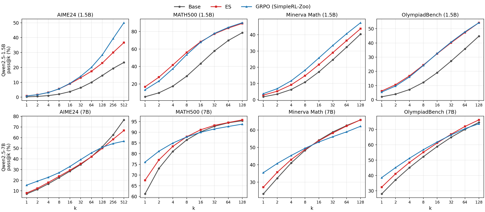

<div align="center">
<h1>What Post-Training Changes: Reasoning Gains and Safety Side Effects of ES vs RL</h1>

[Jaysen Ma](https://github.com/Jaysen-Ma)

<a href="writeup/writeup.pdf"></a> <a href="https://huggingface.co/zocrate/Qwen2.5-7B-ES-math"></a>
</div>

## Overview

Post-training with group relative policy optimisation (GRPO) can make a language model more likely to solve a maths problem on its first attempt, while narrowing the range of problems it can solve under repeated sampling ([Yue et al.](https://arxiv.org/abs/2504.13837)). Is this narrowing specific to GRPO, or does it also occur with alternative post-training methods?

The narrowing observed after maths-only RL post-training with GRPO raises a broader question: how much do different post-training methods change model behaviour beyond mathematical performance? In particular, do they also affect moral judgement, and what might those effects imply for safety and alignment as training is scaled up?

[Evolution strategies (ES)](https://arxiv.org/abs/2509.24372) offer a different approach to RL post-training, using reward-guided parameter perturbations without backpropagation. Comparing ES with GRPO allows us to investigate whether these methods differ in both their reasoning coverage and their effects on moral judgement.

We compare Qwen2.5-1.5B and Qwen2.5-7B base models with ES and GRPO checkpoints trained on the same set of 8,523 maths problems. We evaluate mathematical performance across sampling budgets, general knowledge on MMLU, and moral judgement on ETHICS.

### Reasoning capacity (pass@k)

We compare each post-trained model with its base using pass@k: the probability of obtaining at least one correct answer in k attempts.

We evaluate four maths benchmarks, with up to 512 attempts per question on AIME24 and 128 on MATH500, Minerva Math and OlympiadBench.



> *Figure: pass@k of base, ES and GRPO (SimpleRL-Zoo) on AIME24, MATH500, Minerva Math and OlympiadBench; top row Qwen2.5-1.5B, bottom row Qwen2.5-7B.*

**At 1.5B, both methods improve performance across the measured sampling budgets.** ES and GRPO outperform the base model at every evaluated k on all four benchmarks. We find no evidence of narrowing within this range.

**At 7B, stronger first-attempt performance does not always translate into broader coverage.** GRPO achieves the highest pass@1 on all four benchmarks, but falls below the base model on each at the largest evaluated k. ES matches or exceeds the base at the largest k on **3 out of 4 tasks**, falling below it on AIME24.

Narrowing is therefore not exclusive to GRPO in these experiments, although it appears more consistently across benchmarks for GRPO than for ES. The difference between the 1.5B and 7B results also raises a question about when narrowing emerges. With one training run per method at each size, unequal training budgets and different reward graders, we cannot isolate the effects of model size or training method.

### Moral judgement (ETHICS)

Maths-only post-training can also affect behaviour outside maths. To examine this, we evaluate all six models on the five [ETHICS](https://arxiv.org/abs/2008.02275) subsets: commonsense, deontology, justice, virtue and utilitarianism. These tasks assess agreement with labelled judgements about moral scenarios; none was used for post-training.

**ES reduces accuracy on some ETHICS subsets at both 1.5B and 7B.** At 1.5B, ES lowers scores on deontology, justice and virtue. At 7B, it lowers commonsense accuracy. All four declines are statistically significant after correcting for multiple comparisons.

GRPO shows no statistically significant declines on ETHICS at either model size.

These changes occur despite stable general knowledge performance: all post-trained models remain within 0.5 percentage points of their base on MMLU, with no statistically significant differences.

| Subset | Chance | 1.5B Base | 1.5B ES | 1.5B GRPO | 7B Base | 7B ES | 7B GRPO |
|---|---|---|---|---|---|---|---|
| Commonsense | 50.0* | 52.79 | 53.23 | 52.23 | 63.42 | **57.68** | 63.40 |
| Deontology | 6.25 | 9.8 | **4.1** | **12.3** | 24.5 | 23.9 | 24.0 |
| Justice | 6.25 | 16.0 | **7.0** | 16.3 | 29.1 | 31.7 | 30.5 |
| Virtue | 3.1 | 46.8 | **42.9** | 47.0 | 56.9 | 56.5 | 57.0 |
| Utilitarianism | 50.0 | 51.1 | 52.5 | 52.4 | 73.5 | 72.5 | 73.7 |

Scores are zero-shot accuracies (%), based on the relative likelihoods of two candidate replies. **Bold** entries indicate a statistically significant change from the corresponding base model under an exact McNemar test with Bonferroni correction across 20 comparisons (p < 0.0025).

Deontology, justice and virtue are scored in groups of four, four and five related items; a group counts as correct only when every item is answered correctly. Utilitarianism compares preferences across both scenario orders. \*For commonsense, always answering “not wrong” achieves 53.3%. Full p-values are reported in the [write-up](writeup/writeup.pdf).

These results show that maths-only evolutionary post-training can improve mathematical performance and preserve general knowledge scores while reducing accuracy on moral judgement tasks. The declines observed with ES motivate investigating how these effects develop as evolutionary training scales up, and what they might imply for safety and alignment. The present experiments do not establish that trajectory, and ETHICS scores capture only a narrow aspect of behaviour relevant to these questions.

## Limitations

- One training run per method.
- Not compute-matched: GRPO saw 8x the data and 2x the generations; ES ran 1/10 of the recommended iterations.
- Grader confound: GRPO was trained with the same lenient answer extraction used for eval; ES was rewarded for `\boxed{}` only. Re-scoring with eight answer graders gives the same direction at 7B.

## Evaluation

Versioned package downloads are distributed through
[GitHub Releases](https://github.com/Jaysen-Ma/es-vs-rl-post-training/releases)
once published. See the [release notes](CHANGELOG.md) and
[wheel installation instructions](RELEASING.md#install-a-release).

For analysis of saved outputs, install [uv](https://docs.astral.sh/uv/getting-started/installation/) and use the locked Python environment:

```bash
uv sync --locked --group analysis
uv run --locked --group analysis python scripts/plot_hero.py
```

This installs the shared package and regenerates the pass@k figure from committed summaries. Model evaluation requires a separate GPU environment; install the shared package into an existing environment with `python -m pip install -e .`. See [Development and reproduction](DEVELOPMENT.md) for input requirements, environment boundaries and the recorded external repository revisions.

To try pass@k analysis without downloading models or evaluation data:

```bash
uv run --locked --group analysis es-capacity-passk --example --out /tmp/passk-example --plot
```

This uses four synthetic questions with four correctness scores each, writing
`synthetic_summary.json` and `synthetic_passk.png`. The example is bundled in the
installed package; its numbers are illustrative, not study results.

To analyse your own saved maths outputs from the external evaluation harness:

```bash
uv run --locked --group analysis es-capacity-passk --results-dir /path/to/run --out /path/to/summaries --label base --label trained --label rl --baseline base --plot
```

Inputs follow `RUN/LABEL/BENCHMARK/*.jsonl`. The command runs from any directory
once installed; pass explicit paths to its inputs and outputs. Its pass@k
estimator and JSON format are unchanged, and generation and grading continue to
use the existing limit-of-RLVR fork. Existing `scripts/passk/analyze.py --run-tag`
commands remain available. See [input and output details](DEVELOPMENT.md#passk-analysis).

To regenerate ETHICS summaries from saved predictions, without running models:

```bash
uv run --locked --group analysis es-capacity-ethics --results-dir results/ethics_results --subset commonsense
uv run --locked --group analysis es-capacity-ethics --results-dir results/ethics_results --subset rest
```

These commands require the raw per-arm sample files, which are excluded from Git,
and replace the corresponding CSV summary in the supplied results directory.

For MMLU tables from saved evaluator outputs:

```bash
uv run --locked --group analysis es-capacity-mmlu --results-dir /path/to/mmlu-run --out /path/to/mmlu-summary
```

This writes `scores.csv` in the output directory and prints a Markdown table.
See [MMLU input requirements](DEVELOPMENT.md#mmlu-analysis).

For GPQA seed-sweep summaries and Markdown tables:

```bash
uv run --locked --group analysis es-capacity-gpqa summarize --results-dir /path/to/gpqa-sweep --out /path/to/gpqa-summary --pair 7B-ES:7B-base
uv run --locked --group analysis es-capacity-gpqa tables --results-dir /path/to/gpqa-summary
```

Use `es-capacity-gpqa check --results-dir PATH` to validate a sweep without writing
outputs. See [GPQA input and output details](DEVELOPMENT.md#gpqa-analysis).

To plot saved weight-comparison CSVs without loading checkpoints:

```bash
uv run --locked --group analysis es-capacity-weights --scale 7B --results-dir /path/to/weight-comparisons --out /path/to/weight-figures
```

This writes the five weight-distribution figures. See
[required CSVs and output filenames](DEVELOPMENT.md#weight-distribution-figures).

### Evaluate downloaded models

You do not need to train models to use this repository. If you already have the
checkpoints, configure their local paths. Otherwise, download the checkpoints you
want to evaluate from these model repositories first:

| Model arm | Download |
|---|---|
| `1.5B-base` | [Qwen2.5-1.5B](https://huggingface.co/Qwen/Qwen2.5-1.5B) |
| `1.5B-ES` | [Qwen2.5-1.5B-ES-math](https://huggingface.co/zocrate/Qwen2.5-1.5B-ES-math) |
| `1.5B-RL` | [Qwen-2.5-1.5B-SimpleRL-Zoo](https://huggingface.co/hkust-nlp/Qwen-2.5-1.5B-SimpleRL-Zoo) |
| `7B-base` | [Qwen2.5-7B](https://huggingface.co/Qwen/Qwen2.5-7B) |
| `7B-ES` | [Qwen2.5-7B-ES-math](https://huggingface.co/zocrate/Qwen2.5-7B-ES-math) |
| `7B-RL` | [Qwen-2.5-7B-SimpleRL-Zoo](https://huggingface.co/hkust-nlp/Qwen-2.5-7B-SimpleRL-Zoo) |

`RL` denotes the GRPO checkpoints and retains the labels used in the saved results.
Download each full Hugging Face checkpoint directory, including weights, model
configuration and tokenizer files. Our runners use local checkpoints and do not
fall back to downloading a model when a path is missing.

```bash
cp config.example.toml config.toml
# Edit config.toml to point each selected arm to its downloaded checkpoint.
es-capacity-models check --config config.toml --arms 7B-base 7B-ES 7B-RL
```

Directories may have any names and need not share a parent. Relative paths are
resolved from the configuration file's directory. You can keep just the model
entries you use and select those arms with `--arms`. The checker validates that
paths contain `config.json`; the evaluation runtime checks the remaining files.
The checker works with the core package, without GPU dependencies.

Pass the same configuration to every workflow, using the appropriate evaluation
or checkpoint-analysis environment described in [Development and reproduction](DEVELOPMENT.md):

```bash
es-capacity-evaluate mmlu --config config.toml --arms 7B-base 7B-ES 7B-RL --out /path/to/mmlu-run
es-capacity-evaluate ethics --subset commonsense --config config.toml --arms 7B-base 7B-ES 7B-RL --out /path/to/ethics-run
python scripts/ethics/run_rest.py --config config.toml --arms 7B-base 7B-ES 7B-RL --data-dir /path/to/ethics/ethics
es-capacity-evaluate gpqa --config config.toml --arms 7B-base 7B-ES 7B-RL --out /path/to/gpqa-sweep
python scripts/weights/compare.py --config config.toml --scale 7B
```

MMLU evaluation runs one model per worker process; use `es-capacity-mmlu` to
analyse the saved outputs. See [MMLU evaluation settings and environment
requirements](DEVELOPMENT.md#mmlu-model-evaluation). The legacy
`python scripts/mmlu/run.py` command remains available.

GPQA evaluation reuses each loaded model across answer-order seeds 0–9 by default.
See [GPQA evaluation settings](DEVELOPMENT.md#gpqa-model-evaluation); the legacy
`python scripts/gpqa/run_sweep.py` command remains available.

For ETHICS commonsense, supply `--csv /path/to/cm_test.csv` to use an existing
dataset, or let the runner prepare the official test data under `--out`. See
[commonsense evaluation details](DEVELOPMENT.md#ethics-commonsense-evaluation).
The old `scripts/ethics/run.py` command remains available; the other four subsets
still use `scripts/ethics/run_rest.py`.

Maths evaluation uses the external [limit-of-RLVR](https://github.com/Jaysen-Ma/limit-of-RLVR)
harness. Install this package in that environment too, then set the harness path:

```bash
export MATH_EVAL_DIR=/path/to/limit-of-RLVR/math/examples/math_eval
bash scripts/passk/run_eval.sh --config config.toml 7B-base base my-run
```

To use a configuration from any working directory, set
`ES_CAPACITY_CONFIG=/absolute/path/to/config.toml` instead of passing `--config`.
Explicit `--config` takes precedence. Configuration is unnecessary when analysing
saved predictions or regenerating figures. Training-repository revisions are
recorded separately in [external-repositories.toml](external-repositories.toml)
as study setup references.

## Acknowledgements

Built on [VsonicV/es-at-scale](https://github.com/VsonicV/es-at-scale) (ES training) and [LeapLabTHU/limit-of-RLVR](https://github.com/LeapLabTHU/limit-of-RLVR) (pass@k evaluation). GRPO checkpoints from [SimpleRL-Zoo](https://github.com/hkust-nlp/simpleRL-reason).

## Citation

```bibtex
@misc{ma2026esvsrl,
  title={What Post-Training Changes: Reasoning Gains and Safety Side Effects of ES vs RL},
  author={Ma, Jaysen},
  year={2026},
  howpublished={\url{https://github.com/Jaysen-Ma/es-vs-rl-post-training}}
}
```

