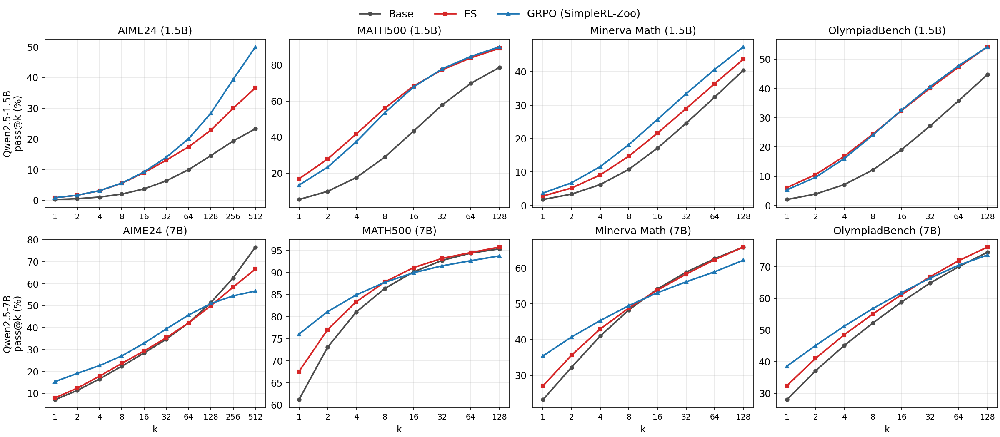

<div align="center">
<h1>What Post-Training Changes: Reasoning Gains and Safety Side Effects of ES vs RL</h1>

[Jaysen Ma](https://github.com/Jaysen-Ma)

<a href="writeup/writeup.pdf"></a> <a href="https://huggingface.co/zocrate/Qwen2.5-7B-ES-math"></a>
</div>

## Overview

RL with verifiable rewards (RLVR) raises pass@1 on maths but tends to narrow the base model's pass@k ceiling ([Yue et al.](https://arxiv.org/abs/2504.13837)). We ask two questions:

> **Does backprop-free Evolution Strategies (ES) post-training avoid that narrowing?**
>
> **Does maths-only post-training shift moral judgements?**

We train Qwen2.5-1.5B and 7B with ES ([Qiu et al.](https://arxiv.org/abs/2509.24372); σ=0.001, population 32, 50 iterations) on the same 8,523 problems as the public [SimpleRL-Zoo](https://arxiv.org/abs/2503.18892) GRPO checkpoints, and compare base, ES and GRPO at pass@k up to 512.

### Reasoning capacity (pass@k)

The curves below show whether each trained model stays above its base as the number of samples k grows.



> *Figure: pass@k of base, ES and GRPO (SimpleRL-Zoo) on AIME24, MATH500, Minerva Math and OlympiadBench; top row Qwen2.5-1.5B, bottom row Qwen2.5-7B.*

**At 1.5B, neither ES nor GRPO narrows the ceiling.** Both stay above base at every k on all four benchmarks.

**At 7B, GRPO leads at small k but falls below base as k grows; ES finishes at or above base on 3 of 4.** GRPO is above base up to k=64 on AIME24 and OlympiadBench and up to k=8 on MATH500 and Minerva, then ends below base on all four. ES ends at or above base on MATH500, Minerva and OlympiadBench, and below base on AIME24 from k=128.

**Open question.** Does RLVR ceiling narrowing appear only at larger scale? GRPO narrowed at 7B but not at 1.5B here, but the 1.5B arms may be under-trained and there is one run each, so this is untested.

### Moral judgement (ETHICS)

We score the same six models zero-shot on the five ETHICS subsets ([Hendrycks et al.](https://arxiv.org/abs/2008.02275)), none of which any arm was trained on.

**Capability and moral judgement can move separately.** Neither method changed MMLU (all arms within 0.5 points of base), yet at 7B maths-only ES lowered ETHICS commonsense accuracy 63.42→57.68% (McNemar p=9e-34) while GRPO was unchanged. A post-training method can preserve or improve capability while shifting moral judgements, and a capability check alone can miss it. This is one run per method, seen at one set-up only.

Zero-shot log-likelihood of two reply words; accuracy %. **Bold** = change vs. own base passes exact McNemar with Bonferroni correction (0.05/20).

| Subset | Chance | 1.5B Base | 1.5B ES | 1.5B GRPO | 7B Base | 7B ES | 7B GRPO |
|---|---|---|---|---|---|---|---|
| Commonsense | 50.0* | 52.79 | 53.23 | 52.23 | 63.42 | **57.68** | 63.40 |
| Deontology | 6.25 | 9.8 | **4.1** | **12.3** | 24.5 | 23.9 | 24.0 |
| Justice | 6.25 | 16.0 | **7.0** | 16.3 | 29.1 | 31.7 | 30.5 |
| Virtue | 3.1 | 46.8 | **42.9** | 47.0 | 56.9 | 56.5 | 57.0 |
| Utilitarianism | 50.0 | 51.1 | 52.5 | 52.4 | 73.5 | 72.5 | 73.7 |

p-values are in the [write-up](writeup/writeup.pdf). \*Always answering "not wrong" scores 53.3%. Deontology, justice and virtue count a contrast set (4, 4, 5 items) only if every item is right; utilitarianism compares yes-vs-no log-odds across both scenario orders.

## Limitations

- One training run per method.
- Not compute-matched: GRPO saw 8x the data and 2x the generations; ES ran 1/10 of the recommended iterations.
- Grader confound: GRPO was trained with the same lenient answer extraction used for eval; ES was rewarded for `\boxed{}` only. Re-scoring with eight answer graders gives the same direction at 7B.

## Further work

- Repeated runs per method to test whether the ethical values shift is specific to ES, whether it holds for larger models and other model families, and whether it also happens under GRPO/RL.

## Evaluation

```bash
cp config.example.sh config.sh   # fill in MATH_EVAL_DIR and model paths
scripts/passk/run_eval.sh QWEN25_7B_BASE base my-run   # pass@k (needs Jaysen-Ma/limit-of-RLVR, branch fix/math-equal-timeout-bypass)
python scripts/ethics/run.py --arms <arms>        # ETHICS commonsense
python scripts/ethics/run_rest.py --arms <arms>   # other four ETHICS subsets
```

CPU regression checks (with NumPy, SciPy and Matplotlib installed): `python -m unittest discover -s tests -v`.

ES training uses [Jaysen-Ma/es-at-scale](https://github.com/Jaysen-Ma/es-at-scale) (branch `fix/multi-engine-colocation`). MMLU, GPQA and weight-change scripts are in `scripts/mmlu`, `scripts/gpqa`, `scripts/weights`.

**Checkpoints:** [zocrate/Qwen2.5-1.5B-ES-math](https://huggingface.co/zocrate/Qwen2.5-1.5B-ES-math) · [zocrate/Qwen2.5-7B-ES-math](https://huggingface.co/zocrate/Qwen2.5-7B-ES-math)

## Acknowledgements

Built on [VsonicV/es-at-scale](https://github.com/VsonicV/es-at-scale) (ES training) and [LeapLabTHU/limit-of-RLVR](https://github.com/LeapLabTHU/limit-of-RLVR) (pass@k evaluation). GRPO checkpoints from [SimpleRL-Zoo](https://github.com/hkust-nlp/simpleRL-reason).

## Citation

```bibtex
@misc{ma2026esvsrl,
  title={What Post-Training Changes: Reasoning Gains and Safety Side Effects of ES vs RL},
  author={Ma, Jaysen},
  year={2026},
  howpublished={\url{https://github.com/Jaysen-Ma/es-vs-rl-post-training}}
}
```

